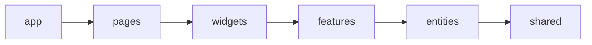

# Async URL Checker

A small full-stack service that accepts a batch of URLs, probes them asynchronously with HTTP `HEAD`,
and shows live per-URL progress. Jobs are stored in memory by design.

## Quick start

Requirements: Node.js 24 (LTS) and npm 11.

```bash
npm ci
cp .env.example .env
npm run dev
```

Open <http://localhost:5173>. The API runs at <http://localhost:3000>, and Swagger UI is available at
<http://localhost:3000/docs>.

The API reads the root `.env` file when started through the workspace scripts:

| Variable                  | Default                 | Meaning                                      |
| ------------------------- | ----------------------- | -------------------------------------------- |
| `PORT`                    | `3000`                  | API listen port                              |
| `WEB_ORIGIN`              | `http://localhost:5173` | Allowed development browser origin           |
| `PROBE_TIMEOUT_MS`        | `5000`                  | Timeout for one HEAD request                 |
| `MAX_CONCURRENCY_PER_JOB` | `5`                     | Worker count per job, from 1 through 5       |
| `MAX_RESULT_DELAY_MS`     | `10000`                 | Artificial pre-commit delay, from 0 to 10000 |

The per-job limit is fixed at 100 URLs in the shared API contract used by validation, Swagger, and the
frontend. `PORT` accepts values from 1 through 65535; `PROBE_TIMEOUT_MS` is capped at the largest delay
that Node timers can represent without overflow (2147483647 ms).

## Architecture

This is an npm-workspaces monorepo:

```text
apps/api             NestJS API and in-memory worker pools
apps/web             React, Vite, Redux Toolkit, RTK Query, CSS Modules
packages/contracts   framework-neutral shared API types and statuses
docs/adr              explicit decisions and consequences
```

The frontend follows Feature-Sliced Design. ESLint boundaries enforce this dependency direction and
reject cross-slice deep imports; Steiger independently checks FSD structure and public APIs.



`pages/jobs` composes three widgets. `jobs-dashboard` is a slot-based layout and therefore does not
import sibling widgets. Every slice exposes an `index.ts` public API.

The backend keeps useful boundaries without adding ceremony:

- `JobsService` owns HTTP-facing use cases;
- `JobsProcessor` owns background worker loops;
- `JobsRepository`, `UrlProbe`, `DelaySource`, and `RandomSource` are replaceable ports;
- production adapters are an in-memory repository, `fetch` HEAD probe, system timer, and random source;
- tests replace network and time at those ports.

See [ADR 0001](docs/adr/0001-processing-and-polling.md) for full rationale.

## Key correctness decisions

### Concurrency

Each job creates at most five worker loops. A loop atomically claims one pending item, probes it, waits
the random 0–10 second delay, stores the outcome, and only then claims another item. The implementation
does not eagerly create one promise per URL. Separate jobs have independent pools and can run in
parallel.

### Cancellation

`DELETE` makes the job terminal immediately and marks every pending item `cancelled`. Already claimed
items finish normally, but no worker receives another item and the parent job can never become
`completed`. Explicit transition tables guard terminal states.

### HTTP results

- final HTTP `200–399`: `success`;
- final HTTP `400–599`: `error` with the received status code;
- timeout, DNS, TLS, and transport failures: `error` with a stable, non-sensitive message and no status
  code.

Transport failures are exposed only as `Request timed out`, `DNS lookup failed`, `Connection refused`,
`Connection reset`, `TLS connection failed`, or the safe fallback `Network request failed`. Raw `fetch`
and socket error messages are not returned by the API.

`fetch` follows redirects. There is intentionally no GET fallback for servers that reject HEAD.

### Polling race safety

RTK Query stores details under the query key `getJob(jobId)`. Only the active id is subscribed and
polled. Switching jobs unsubscribes the previous key; a late response remains in the old cache entry and
cannot replace the current UI. Polling stops immediately at `completed` or `failed`. A cancelled job is
polled only until checks that were already in flight have recorded their final URL results.

Temporary network and `5xx` failures keep the active job visible and retry at a reduced five-second
cadence; a successful response restores the normal one-second interval. Permanent `4xx` responses such
as a missing in-memory job pause automatic updates and leave an explicit Retry action.

The global Redux store contains the job list and details with loading/error metadata in RTK Query cache,
plus `activeJobId` in a small UI slice.

## API

| Method   | Path            | Purpose                                                               |
| -------- | --------------- | --------------------------------------------------------------------- |
| `POST`   | `/api/jobs`     | Accept `{ "urls": string[] }`; return `202 { "jobId": string }`       |
| `GET`    | `/api/jobs`     | List newest jobs with status, URL count, and success/error statistics |
| `GET`    | `/api/jobs/:id` | Return job metadata and all URL results                               |
| `DELETE` | `/api/jobs/:id` | Cancel pending work and return current details                        |
| `GET`    | `/api/health`   | Readiness endpoint                                                    |

Job statuses are `pending`, `in_progress`, `completed`, `cancelled`, and `failed`. URL statuses are
`pending`, `in_progress`, `success`, `error`, and `cancelled`. All timestamps are ISO-8601 UTC strings;
durations are milliseconds.

### curl examples

```bash
curl -i -X POST http://localhost:3000/api/jobs \
  -H 'content-type: application/json' \
  -d '{"urls":["https://example.com","https://example.com/missing"]}'

curl http://localhost:3000/api/jobs
curl http://localhost:3000/api/jobs/JOB_ID
curl -X DELETE http://localhost:3000/api/jobs/JOB_ID
```

Invalid payloads and unsupported protocols return `400`; unknown job ids return `404`.

## Docker

Both images use multi-stage builds. nginx serves the built SPA and proxies `/api` to NestJS, so the
production browser uses one origin.

```bash
docker compose config --quiet
docker compose build --pull
docker compose up --detach --wait
curl --fail http://127.0.0.1:8080/api/health
```

Open <http://localhost:8080>. Both services have health checks. `docker compose down` stops them.

## Quality commands

```bash
npm run lint                 # TypeScript/React rules, cycles, FSD boundaries
npm run architecture         # ESLint boundaries plus Steiger
npm run architecture/check   # explicit alias for the architecture gate
npm run typecheck            # strict TypeScript in every app/package
npm test                     # deterministic backend and frontend tests
npm run test:e2e             # Nest HTTP e2e tests through Supertest
npm run build                # production builds
npm run check                # every gate above, formatting included
```

Tests never use the public internet or the production 0–10 second delay. Backend tests cover the worker
limit, parallel jobs, cancellation/in-flight behavior, processor failures, the production HEAD adapter,
error semantics, statistics, transitions, validation, 404s, health, and all job endpoints. Frontend
tests cover parsing and limits, creation/activation, cancellation settlement, cached-data refresh errors,
transient polling recovery, permanent-error cleanup, and the late-response race.

GitHub Actions runs `npm ci` followed by `npm run check`; a separate job validates Compose, builds both
production images, starts the stack, and smoke-tests the nginx-to-API health route.

## Manual verification

1. Start both apps with `npm run dev`.
2. Submit more than five URLs and observe at most five `in_progress` rows for one job.
3. Create a second job and switch between the two recent-job cards.
4. Cancel a running job; pending rows become cancelled and no new rows start.
5. Let another job finish and confirm polling reports a terminal state.
6. Try an invalid URL, blank input, and duplicates to inspect accessible inline feedback.
7. Open Swagger UI and exercise the same endpoints directly.

For a fast backend-only smoke check, set `MAX_RESULT_DELAY_MS=0` in `.env` before starting the API.

## Honest limitations and trade-offs

- Docker Compose intentionally binds the web service to `127.0.0.1`. Do not expose this build to a
  public network: it does not include the SSRF and multi-user abuse controls described below.
- All state disappears on API restart and does not work across multiple API replicas.
- Completed jobs are retained in memory until that restart; there is no TTL or eviction policy.
- Cancellation does not abort an already issued HEAD request; its individual result is retained.
- Arbitrary URL checking can reach private network addresses. A public production service would need
  SSRF controls, DNS/IP revalidation, authentication, quotas, and abuse protection.
- A site that supports GET but rejects HEAD is reported as an error, matching the assignment literally.
- There is no queue persistence, retry policy, historical pagination, or distributed concurrency limit.
- The limit is per job, not global: `N` simultaneous jobs may issue up to `5 × N` HEAD requests.
- The API returns the full in-memory history and the UI renders its 20 newest jobs; server-side pagination
  is intentionally outside the assignment scale.

These are conscious three-day-assignment boundaries, not hidden production claims.

## Development note

AI tools were used during development for implementation support and code review. The final solution was
reviewed and tested, and its architecture and trade-offs are documented in this repository.
